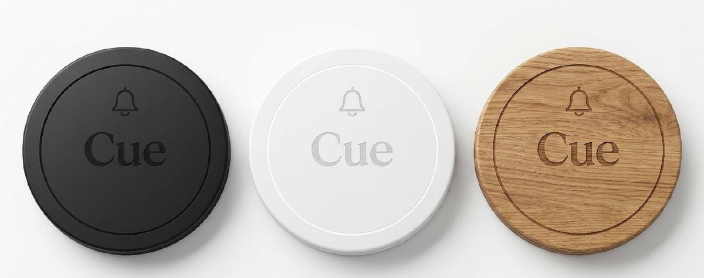
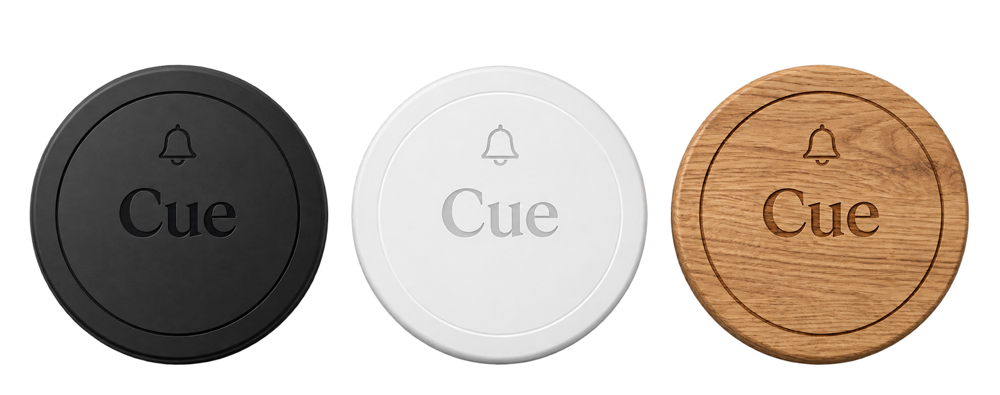
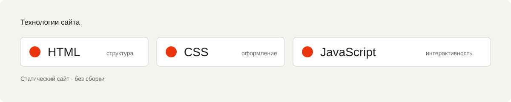

# Cue

**Cue — система связи гостя и ресторана**

Ознакомительный сайт о системе вызова официанта: от кнопки на столе до уведомления команды ресторана.

  

## О сайте

Сайт рассказывает, как работает Cue, показывает ориентировочную модель оплаты и сравнивает подходы к вызову официанта. В блоке сравнения прокрутка последовательно раскрывает карточки; при уменьшенной анимации карточки доступны обычным списком.

## Технологии

- `index.html` — содержание и разметка страницы
- `style.css` — оформление и адаптивная вёрстка
- `script.js` — слайдер кнопок и интерактивное сравнение
- `images/` — изображения продукта, иконка и иллюстрации

## Источники данных

Цены и сравнение решений взяты из презентации Cue от 8 ноября 2026 года и приведены как ориентир. Перед использованием в коммерческом предложении проверьте актуальность условий и данных о конкурентах.

## Лицензия

Проект распространяется по [лицензии MIT](LICENSE).
